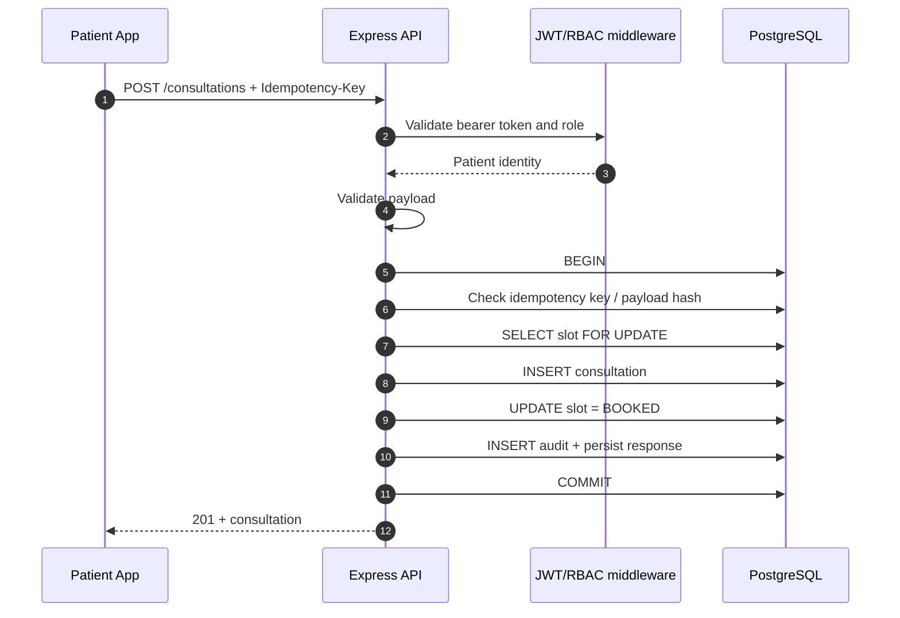
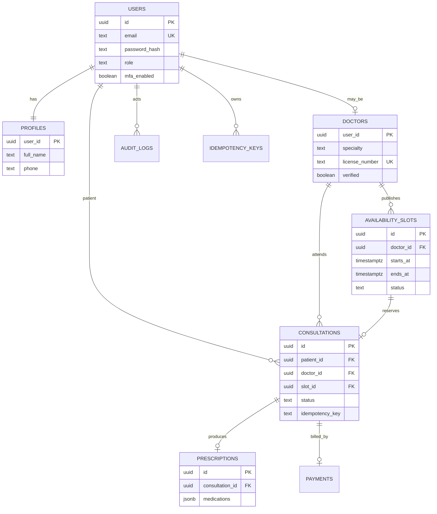
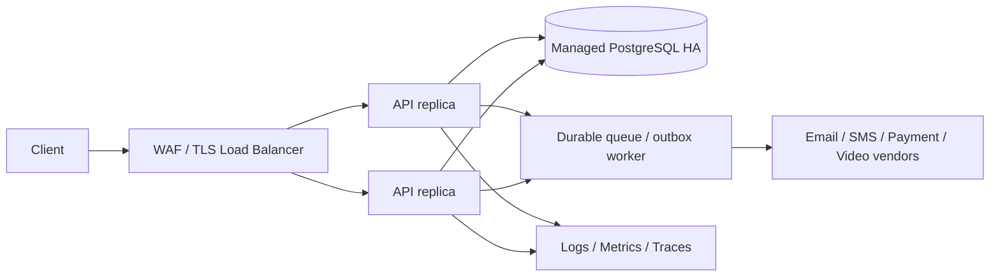

# Telemedicine Backend — Architecture and Operations

## 1. Overview

This repository is a modular-monolith REST API built on Node.js 20+, Express, PostgreSQL and JWT. A modular monolith is the deliberately simple starting point: authentication, doctor discovery, booking, consultation lifecycle, prescriptions, audit and analytics have separate route/service boundaries but deploy as one stateless API. It reduces operational overhead for a small team while allowing modules to be extracted later when measured load or team ownership justifies it.

### High-level components

- **API edge:** TLS termination at ingress/load balancer, request IDs, Helmet headers, CORS allowlist, JSON body limit and global rate limit.
- **Application:** Express routers → validation/auth middleware → service functions → PostgreSQL repository queries. Dependency boundaries are explicit through modules and injected `pg` pool/client parameters for audit.
- **PostgreSQL:** source of truth for identities, doctor profiles, availability, consultations, prescriptions, payments, idempotency keys and audit events. Constraints protect core invariants.
- **Async work (deployment extension):** use a durable queue (e.g. managed queue) for email/SMS, video session provisioning, reminders, billing webhooks and analytics exports. Do not put long-running work in request handlers. Add an outbox table in the same transaction as domain writes before publishing events.
- **Observability:** structured Pino logs with request ID and redaction, Prometheus metrics, liveness/readiness probes. Add OpenTelemetry SDK/auto-instrumentation at deployment to export traces to the chosen collector/backend.
- **Infrastructure:** Docker image, Compose for local use, Kubernetes/managed container platform and managed PostgreSQL for production. Terraform starter below documents the deployment boundary; provider-specific resources must be filled and reviewed for your cloud.

### Data flow

1. Client sends HTTPS request with bearer access token and (for writes) an idempotency key.
2. Ingress applies TLS, request-size limits and edge/WAF controls; API assigns/propagates a request ID.
3. Middleware enforces HTTP security headers, CORS, rate limits, authentication, role authorization and Zod schemas.
4. Service performs parameterized SQL. Booking opens a transaction, locks the slot row `FOR UPDATE`, checks availability and doctor verification, creates consultation, marks slot booked, stores idempotent response and writes audit event.
5. Transaction commits; response returns with request ID. Metrics record latency/status; logs exclude authorization and password fields.

## 2. Booking sequence

If the same key is retried with the same payload, the saved response is returned. Reusing a key with a different payload returns 409. The unique slot constraint and row lock prevent two patients from successfully booking the same slot.

## 3. Data model

## 4. Scalability and latency

100k consultations/day averages about 1.16 consultations/second; bursts and read traffic may be much higher. Capacity must be validated with load tests using realistic concurrency and data volume. The stated p95 goals (<200ms reads, <500ms writes) are targets, not guaranteed by this starter.

- Keep API stateless; scale horizontally behind a load balancer.
- Tune PostgreSQL connection pool per replica so total connections stay within database limits; use PgBouncer/managed pooling for many replicas.
- Use the included indexes as a baseline and inspect `EXPLAIN (ANALYZE, BUFFERS)` against production-like data.
- Add Redis only for measured hot, non-sensitive reads such as public doctor search. Never use cache as the booking lock or source of truth. Cache keys must include filter/version and have short TTL/invalidation.
- Partition high-volume append-only audit logs by `created_at` (monthly) and optionally consultations by time only after query patterns and foreign-key/unique-key requirements are reviewed. Retention and partition maintenance should be automated.
- Use cursor pagination for large lists rather than unbounded OFFSET. Set per-route limits and query timeouts.
- Offload email/SMS, reminders, exports, payment reconciliation and report generation to durable jobs. Use retries with exponential backoff + full jitter, bounded attempts, dead-letter queue, idempotent consumers, and alerting.

## 5. Reliability, concurrency, transactions and sagas

Booking is a local ACID transaction; row locking, unique constraints and idempotency keys protect against concurrent/retried requests. Keep transaction scopes short and never call remote services inside a DB transaction. For multi-system workflows (payment provider, video vendor, notifications), use a saga: persist state and outbox event atomically, process asynchronously, record each step, retry safe steps, and issue compensating actions (e.g. release slot/refund payment) on terminal failure. Webhook handlers must verify provider signatures and deduplicate provider event IDs.

Retry only transient errors (timeouts, 429, 502/503/504, SQL serialization/deadlock where safe). Exponential delay: `min(cap, base * 2^attempt) + random(0, jitter)`; honor `Retry-After`; cap attempts and total elapsed time. Do not automatically retry validation, authorization, or non-idempotent writes without a stable idempotency key.

## 6. Security, privacy and compliance

- Passwords use bcrypt cost 12; passwords are never logged. Access JWTs are short-lived and signed with a secret validated at startup.
- RBAC is enforced server-side. Sensitive record reads must additionally verify resource ownership (as in prescriptions and doctor status updates).
- TLS is required at ingress. Configure managed database encryption at rest, encrypted backups, KMS-backed secrets and key rotation in production.
- MFA: schema supports enabling MFA, but a production rollout must implement TOTP/WebAuthn enrollment, recovery codes, step-up auth, and challenge verification before marking users enabled. This starter deliberately refuses to issue a token when MFA is enabled without a verified challenge.
- Treat medical reason, prescription, DOB, phone and consultation metadata as sensitive health/personal data. Minimize collection, mask logs, enforce least privilege, define retention/deletion, consent and breach response. Determine applicable India DPDP Act/rules and healthcare obligations with qualified counsel; this code is not a compliance certification.
- Audit logs should be append-only to application roles, exported to tamper-resistant storage, monitored, and retained per approved policy. Avoid putting health details in audit metadata.
- Run dependency/container scanning, SAST, secret scanning, image signing and SBOM generation in CI/CD.

## 7. Backup, disaster recovery and SLO

Suggested initial production objectives (agree with product/legal/business): managed PostgreSQL PITR with 5–15 minute RPO, cross-region encrypted daily backup, quarterly restore drills, and documented RTO (e.g. 1 hour). These are recommendations, not provisioned defaults. Use multi-zone DB, at least two API replicas across zones, health-based rollout and tested rollback. 99.95% availability permits ~21.6 minutes downtime per 30-day month; achieving it requires operational coverage, redundancy, and incident response beyond code.

## 8. Deployment topology

